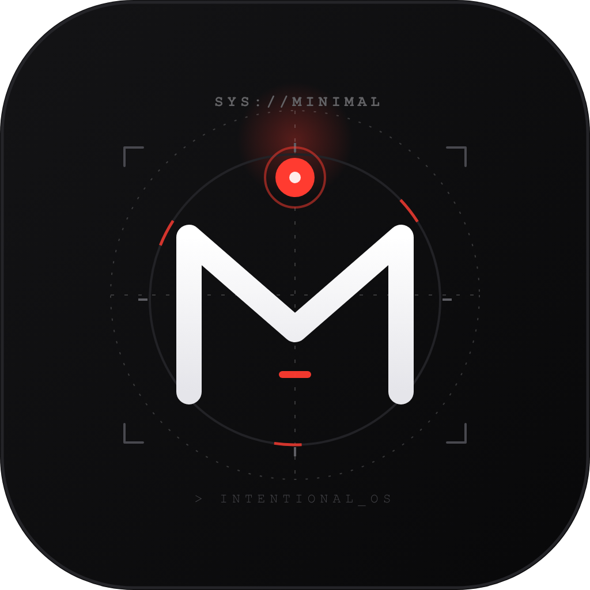
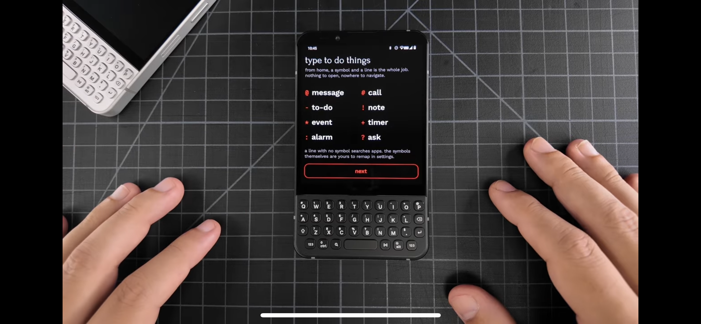
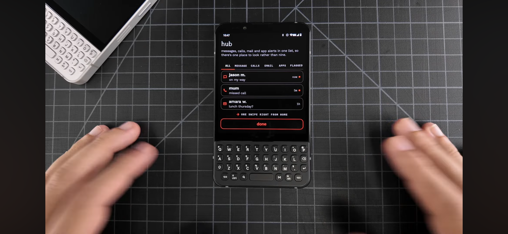
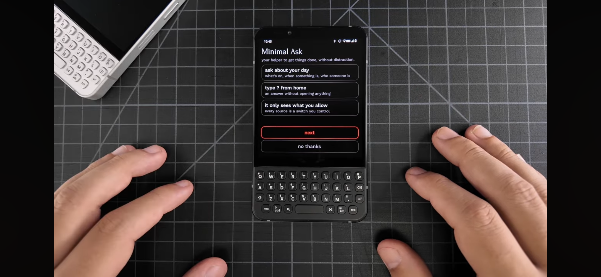
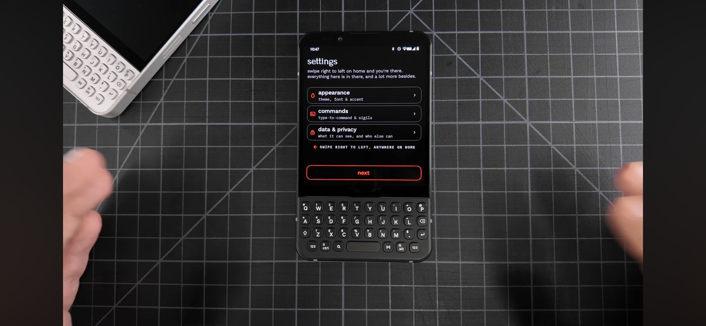
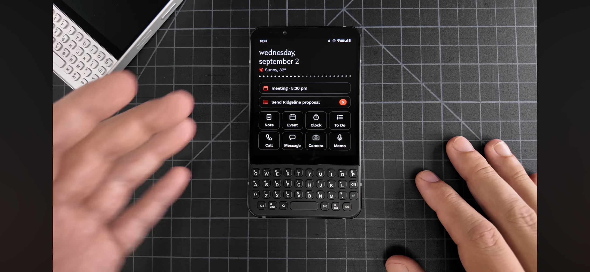

# Minimal OS Launcher

<div align="center">


<br/><br/>

[](https://github.com/zaryif/Minimal_os/actions/workflows/build.yml)
[](https://github.com/zaryif/Minimal_os/releases/latest)
[](https://www.android.com)
[](https://developer.android.com/jetpack/compose)
[](https://kotlinlang.org)
[](LICENSE)

**An intentional, text-first, terminal-inspired Android home launcher designed to reclaim your attention.**

*Type to do things. One hub for everything. Zero visual noise.*

[Download Latest APK (v1.9.1)](https://github.com/zaryif/Minimal_os/releases/latest) • [Features](#core-features) • [Inspiration & Vision](#what-inspired-it) • [What It Solves](#what-problem-is-it-solving) • [Installation](#installation--setup)

</div>

---

## Visual Overview

| 1. Your Apps | 2. Minimal Ask | 3. Command Bar | 4. Notification Hub | 5. Setup Wizard |
|:---:|:---:|:---:|:---:|:---:|
|  |  |  |  |  |

---

## What Inspired It

Modern smartphones were originally conceived as personal assistants—sharp, responsive instruments to help humans communicate, navigate, and create. Over the last decade, however, the industry transformed our home screens into brightly saturated slot machines engineered by attention merchants to trigger impulsive taps and endless algorithmic scrolling.

**Minimal OS Launcher** was born at the intersection of three distinct design movements:

1. **The Minimal Phone Paradigm**:
   Embracing typography-first minimalism, anti-dopamine layouts, and e-ink aesthetic clarity. High contrast, sharp text, and zero distracting app badges.
2. **Teenage Engineering & Hardware Aesthetics**:
   Tactile, card-based retro-futuristic interfaces. Bold contrast borders, segmented micro-cards, dedicated deck drawers, and crisp mechanical visual hierarchy.
3. **Terminal Shells & T-UI Efficiency**:
   Power users love command-line shells (Bash, Zsh) because typing commands is demonstrably faster than hunting through nested graphical menus. Minimal OS translates this command-line power to touchscreens with dedicated trigger symbols (`-`, `!`, `#`, `@`, `:`, `+`, `*`, `?`, `$`, `%`, `/`), custom shortcut aliases (`yt`, `gh`, `wifi`), and bash-like command history navigation.

---

## What Problem Is It Solving?

### 1. The Dopamine Trap of App Grids
Traditional Android home screens blast you with colorful app icons that trigger neurological dopamine loops. You unlock your phone intending to check an email or set a timer, but notice an Instagram or YouTube icon and lose thirty minutes. **Minimal OS strips away all iconography on the home screen**, replacing apps with clean, neutral typography that requires conscious intent to open.

### 2. High Friction in Mundane Daily Actions
To take a note, set an alarm for 7:30 AM, start a 25-minute Pomodoro timer, uninstall an unused app, or text a contact, traditional OS launchers force you to find an app icon, tap it, wait for splash screens, navigate internal tabs, and execute. **In Minimal OS, the Command Bar executes all of this from one line on your home screen in under two seconds.**

### 3. The "Dumb Phone" Impasse
Many people want digital detox and try purchasing hardware "dumb phones" (feature phones or e-ink phones), only to abandon them within weeks because real life requires modern tools: banking apps, WhatsApp, ride-sharing (Uber/Lyft), 2-factor authentication, music streaming (Spotify), and GPS maps. **Minimal OS turns your existing Android device into a software-defined dumb phone**: total psychological calm without sacrificing a single critical Android application.

### 4. Poor Legibility & The White-on-White Contrast Dilemma
Many monochrome or minimalist launchers suffer from contrast failures where white accents cause invisible white text on bright elements. **Minimal OS introduces the `MinimalOnAccent` adaptive luminance engine**, ensuring that whether you run pure *AMOLED Crimson* or blindingly pure *Nordic Snow*, text, badges, checkboxes, and interactive buttons automatically switch between crisp pure black (`#000000`) and brilliant white (`#FFFFFF`) for flawless WCAG AAA legibility.

---

## Core Features

### 1. Type to Do Things (The Unified Command Bar)

The Command Bar is the brain of Minimal OS. It combines instant app search, contact dialing, system utility shortcuts, natural-language actions, AI assistant prompts, YouTube queries, app uninstallation, and user-defined aliases in one unified input bar.

```
Type keyword or symbol + text  ->  Instant execution
```

| Command / Symbol | Action | Example | Result |
|:---:|:---|:---|:---|
| `uninstall` or `/` | **Uninstall App** | `uninstall chatgpt` or `/chatgpt` | Prompts native confirmation dialog to uninstall the app |
| `assistant` or `?` | **AI Assistant Query** | `assistant what is gravity` | Transmits prompt directly to Gemini, ChatGPT, Claude, or Copilot |
| `yt` or `$` | **YouTube Search** | `yt lofi beats` or `$ lofi beats` | Searches directly in the YouTube Android app or web |
| `pomo` or `%` | **Live Pomodoro** | `pomo 50m` or `pomodoro 50 minute` | Starts real-time home screen Pomodoro countdown timer |
| `@` or `msg` | **Direct SMS** | `@Mom on my way home` | Opens system SMS composer pre-filled to contact |
| `#` or `call` | **Quick Call** | `#Alex` or `#+1234567890` | Instantly dials contact or raw phone number |
| `-` or `task` | **Focus Task** | `-Buy milk and coffee` | Immediately adds task to your Minimal Memo task list |
| `!` or `note` | **Memo / Note** | `!Meeting ideas for Monday` | Saves scratch note into Minimal Memo storage |
| `*` or `event` | **Calendar Event** | `*Flight to Tokyo tomorrow` | Launches calendar intent with pre-filled title |
| `+` or `timer` | **Countdown Timer** | `+15m` or `timer 45s` | Starts a system countdown timer immediately |
| `:` or `alarm` | **Clock Alarm** | `:7:00 AM` or `alarm 8:30am` | Configures system clock alarm for specified time |
| `alias` | **Custom Shortcuts** | `alias gh = https://github.com` | Configures custom user-defined keywords (URLs, apps, or settings) |
| _(app name)_ | **Fuzzy App Search** | `spot` | Real-time app search with instant keyboard launch |
| _(search query)_ | **Web Search** | `weather today` | Fast distraction-free web search in default browser |

> **Directory of 120+ Aliases & System Shortcuts**: Check out the comprehensive [ALIASES_AND_SHORTCUTS.md](ALIASES_AND_SHORTCUTS.md) directory for ready-to-use Android settings intents (`android.settings.WIFI_SETTINGS`, `BLUETOOTH_SETTINGS`, `BATTERY_SAVER_SETTINGS`), dynamic search engines with `{query}`, app package shortcuts, and instructions on finding intent actions and package IDs.

#### Terminal Power Features:
- **Interactive Command History Stream**: When typing, past commands appear in a clean, scrollable card stream. Tap any entry to reload it into the command bar ready to edit or run.
- **Terminal History Storage & Download (.md)**: All terminal commands are continuously logged to a structured markdown file (`minimal_command_history.md`). Users can export and download this `.md` file at any time from Settings using the Android Storage Access Framework.
- **Command History Toggle**: Enable or disable terminal command history recording anytime in Settings.
- **Dynamic Multiline Auto-Expansion**: The command bar automatically expands from 1 line up to 3 lines when typing lengthy notes, tasks, or search queries, eliminating horizontal truncation.
- **Terminal Up/Down Cycling Controls**: Tactile Up and Down controls step through terminal history anytime with live badge tracking (`HIST 1/10`).
- **Inline Syntax Highlighting**: Only the action trigger or alias (such as `uninstall`, `yt`, `pomo`, `assistant`, `todo`, `notes`, `-`, `!`, `#`) lights up in bold theme accent color, while parameters and payload text stay clean, crisp white.
- **Interactive Uninstall Suggestions**: Typing `uninstall` or `uninstall <query>` displays matching installed apps with a dedicated `UNINSTALL` action badge. Tapping any app directly triggers the native system deletion confirmation dialog.
- **Smart Contact Search**: Search your address book with fuzzy matching and inline permission grant fallbacks.

---

## 2. The Widgets Deck Screen (Dedicated Utilities Hub)

Swipe or tap into the **Widgets Deck** to access purpose-built, high-contrast utility cards inspired by retro-futuristic hardware:

- **Live Pomodoro Focus Card**: Built-in 15m, 25m, 45m, and 60m focus chips, custom duration picker dialog, work/break cycle tracker, and tactile play/pause/reset controls. Can also be pinned directly onto the **Home Screen** widgets deck with live countdown controls and matching card width.
- **Custom Alarms & Live Alarm Countdown**: Tactile custom time-picker dialog with full Hour (1–12), Minute (00–59), AM/PM toggles, and Date selection chips plus relative quick presets (`+15m`, `+30m`, `+1h`, `+8h`). Features a **Home Screen Live Alarm Countdown Widget** showing exact time remaining until the next system alarm rings.
- **Minimal Memo with Search & Direct Creation**: Full-featured quick memos and focus tasks. Includes a dedicated real-time **Search Box** to filter notes and tasks, plus a context-aware **Add Input Bar** to type and create tasks or thoughts directly without leaving the sheet.
- **Aliases & Shortcuts Deck**: Quick template creator and 1-tap launcher for your custom shortcuts (e.g. `yt` -> YouTube, `wifi` -> Network Settings, `gh` -> GitHub).
- **Countdown Timers**: Quick-tap timer presets (`1m`, `5m`, `10m`, `15m`, `25m`) that trigger native Android alarms.
- **Native App Widget Host**: Pin standard Android app widgets (Spotify, Google Keep, Weather) directly into the Minimal OS card system.

---

## 3. Unified Notification Hub (Swipe Right)

Stop hopping between 10 different notification shades and apps. The Hub aggregates notifications into a clean, unified stream:
- **Category Tabs**: Filter by `ALL`, `MESSAGE`, `CALLS`, `EMAIL`, `APPS`, and `FLAGGED`.
- **Minimalist Metadata**: Clean typography, relative timestamps (`now`, `5m`, `2h`), and direct 1-tap interaction.
- **Privacy-Minded**: Runs completely locally on your device via Android's `NotificationListenerService`.

---

## 4. Interactive Setup Wizard & Onboarding

Minimal OS includes a comprehensive 5-step onboarding walkthrough designed to introduce new users to the launcher's powers and let them customize their experience immediately:
- **Core Principles & Philosophy**: Clear overview of typography-first minimalism, anti-dopamine layouts, and zero telemetry.
- **Unified Command Box Deep Dive**: Interactive showcase of native uninstallation (`uninstall <app>`), AI routing (`assistant <query>`), YouTube search (`yt <query>`), natural Pomodoro (`pomo 50m`), and symbol shortcuts.
- **Widgets Deck & Live Countdowns**: Introduction to the Live Alarm Countdown Widget, Live Pomodoro Timer, Minimal Memo, and AppWidgetHost.
- **Unified Notification Hub**: Guide to filtering messages, calls, and emails in a single calm stream.
- **Interactive Setup Wizard**: Allows users to pick their starting theme from the 7 handcrafted palettes, toggle home live widgets, enable/disable terminal command history, and select their preferred AI assistant. Replayable anytime in **Settings -> Replay Onboarding**.

---

## 5. Handcrafted Theme Engine & Adaptive Contrast

Minimal OS includes 7 bespoke, high-contrast themes tailored for AMOLED displays, daylight readability, and aesthetic pleasure:

| Theme Name | Dominant Palette | Accent Color | Ideal Use Case |
|:---|:---|:---|:---|
| **AMOLED Crimson** | Pure Pitch Black (`#000000`) | Crimson Red (`#FF3B30`) | Maximum battery saving & classic Minimal OS look |
| **Apple Space Gray** | Deep Charcoal (`#141416`) | Electric Blue (`#0A84FF`) | Sleek, modern iOS/macOS pro look |
| **Nordic Snow** | Pure Contrast Black & Crisp White | Pure White (`#FFFFFF`) | Extreme monochrome minimalism with black-on-white text |
| **Rabbit Amber** | Warm Dark Zinc (`#0D0D0F`) | Industrial Orange (`#FF5722`) | Teenage Engineering & Rabbit r1 tribute |
| **Matrix Forest** | Deep Emerald (`#070E0A`) | Terminal Green (`#10B981`) | Cyberpunk & hacker terminal aesthetic |
| **Midnight Obsidian**| Deep Space Navy (`#060913`) | Glacier Sky (`#38BDF8`) | Calming night-time low-light readability |
| **Titanium Purple** | Shadow Violet (`#0A0714`) | Electric Violet (`#A855F7`) | Rich, vibrant dark mode aesthetic |

> **Adaptive Legibility (`MinimalOnAccent`)**: Minimal OS automatically calculates background luminance. On pure white accent buttons (Nordic Snow), text and icons dynamically render in sharp pure black (`#000000`), guaranteeing zero white-on-white visibility bugs.

---

## Android System Integration

Minimal OS is engineered specifically for Android to feel like an integral part of the operating system:

- **Target SDK 35 (Android 15)** & Backward Compatible to **Android 8.0 (Oreo, API 26)**.
- **System App Uninstallation**: Direct dispatch to `Intent.ACTION_DELETE` with package URI. For system apps, gracefully routes to App Info settings.
- **Digital Assistant Dispatch**: Direct routing to installed AI assistants (ChatGPT, Gemini, Claude, Copilot, Perplexity) via `ACTION_SEND` and `ACTION_ASSIST`.
- **System Alarm & Timer Integration**: Seamlessly dispatches intents to `AlarmClock.ACTION_SET_ALARM` and `AlarmClock.ACTION_SET_TIMER`.
- **System Calendar Intent**: Direct mapping to `CalendarContract.ACTION_INSERT`.
- **Telephony & SMS Intents**: Direct integration with default dialers and SMS apps via `Intent.ACTION_CALL`, `Intent.ACTION_DIAL`, and `Intent.ACTION_SENDTO`.
- **Native Widget Host**: Uses Android `AppWidgetManager` and `AppWidgetHost` to embed third-party widgets cleanly.
- **Zero Cloud Dependence**: 100% of your notes, todos, settings, aliases, and history remain strictly on your device in secure local DataStore storage. **No account required, no telemetry, no analytics, no ads.**

---

## Installation & Setup

### Download APK
Grab the latest release directly from GitHub:

**[Download Minimal OS Launcher v1.9.0 APK](https://github.com/zaryif/Minimal_os/releases/latest)**

### Setting as Default Launcher
1. Install the downloaded `.apk` file (enable *"Install from unknown sources"* if prompted).
2. Press your phone's **Home** button or swipe up to go home.
3. When prompted, select **Minimal OS** and tap **"Always"**.
4. *(Alternatively)* Go to Android **Settings -> Apps -> Default Apps -> Home App -> Minimal OS**.

---

## Architecture & Tech Stack

```
com.zaryif.minimalos
├── data
│   ├── model          # Note, Todo, Notification, App, Theme models
│   ├── preferences    # Jetpack DataStore preferences (Theme, Restrictions, Aliases, History)
│   ├── repository     # StorageRepository, ContactRepository, NotificationRepository
│   └── service        # NotificationListenerService
├── domain
│   ├── parser         # CommandParser (Symbol & natural-language parsing)
│   ├── timer          # PomodoroTimerManager
│   └── usecase        # ExecuteCommandUseCase
└── ui
    ├── apps           # AppDrawerScreen
    ├── components     # CommandBar, MinimalCard, MinimalMemoSheet, Dialogs
    ├── home           # HomeScreen & Home Widgets (Live Pomodoro, Live Alarm)
    ├── onboarding     # OnboardingScreen
    ├── settings       # SettingsScreen (organized by top-brand guidelines)
    ├── theme          # Adaptive Theme, Color, Type
    └── widgets        # WidgetsDeckScreen (Pomodoro, Alarms, Aliases, Timers)
```

- **Language**: Kotlin 2.0+
- **UI Framework**: Jetpack Compose (Material3)
- **Asynchronous Flow**: Kotlin Coroutines & `StateFlow` / `SharedFlow`
- **Preferences**: Jetpack DataStore
- **Build System**: Gradle Kotlin DSL (`build.gradle.kts`)

---

## Documentation Suite

Comprehensive architecture and design documentation is available in the [`docs/`](docs/) directory:
- [Business Requirements Document (BRD)](docs/BRD.md)
- [Software Requirements Specification (SRS)](docs/SRS.md)
- [Software Architecture Document (SAD)](docs/SAD.md)
- [Management Information System (MIS)](docs/MIS.md)
- [Master Plan](docs/Minimal_OS_Launcher_Master_Plan.md)

---

## License

This project is licensed under the [MIT License](LICENSE).

Developed by **MD. Zarif Azfar** ([@zaryif](https://github.com/zaryif)).
