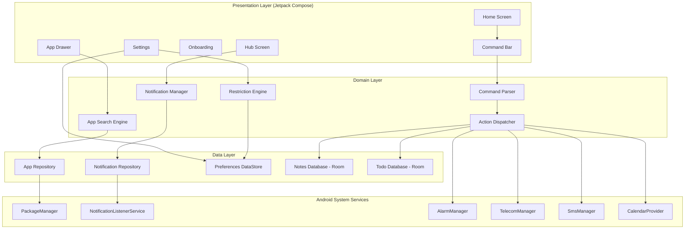
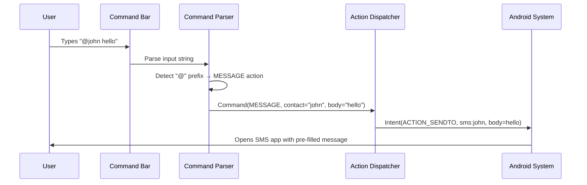
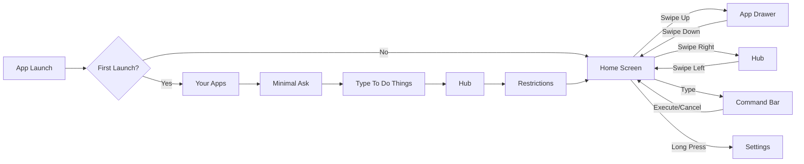
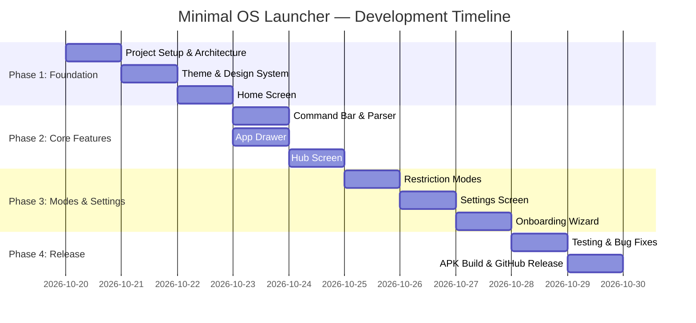

# 📱 Minimal OS Launcher — Master Plan & Documentation

> **Project:** Minimal OS Launcher (Minimal OS)
> **Version:** 1.0.0
> **Author:** MD. Zarif Azfar
> **Date:** October 20, 2026
> **Repository:** `github.com/zaryif/Minimal_os`

---

## Table of Contents

1. [Executive Summary](#1-executive-summary)
2. [Business Requirements Document (BRD)](#2-business-requirements-document-brd)
3. [Software Requirements Specification (SRS)](#3-software-requirements-specification-srs)
4. [Software Architecture Document (SAD)](#4-software-architecture-document-sad)
5. [Management Information System (MIS)](#5-management-information-system-mis)
6. [Feature Catalog](#6-feature-catalog)
7. [UI/UX Design Specification](#7-uiux-design-specification)
8. [Build & Release Plan](#8-build--release-plan)

---

## 1. Executive Summary

Minimal OS Launcher is a **text-first, distraction-free Android home launcher** inspired by the Minimal Phone's UI paradigm. It replaces the conventional icon grid with a clean, dark, typography-driven interface where **typing is the primary interaction model**. Users type symbol-prefixed commands to send messages, set alarms, create notes, make calls, and more — all without opening a single app.

### Core Philosophy
- **Type to do things** — a single line of text replaces navigating through apps
- **One hub for everything** — messages, calls, emails, notifications unified
- **Restrictions by design** — monk mode, focus mode, and unrestricted mode
- **Zero visual noise** — pure black background, white text, red accents only

---

## 2. Business Requirements Document (BRD)

### 2.1 Business Objectives

| ID | Objective | Success Metric |
|----|-----------|----------------|
| BO-1 | Provide a distraction-free Android launcher | < 3 taps to complete any task |
| BO-2 | Reduce screen time for users | 30%+ screen time reduction reported |
| BO-3 | Open-source community-driven development | 100+ GitHub stars in first 3 months |
| BO-4 | Support all Android 8.0+ devices | 95%+ Android device compatibility |

### 2.2 Stakeholders

| Stakeholder | Role | Interest |
|-------------|------|----------|
| End Users | Primary users | Distraction-free phone experience |
| Developer (Zarif) | Creator & maintainer | Portfolio project, community building |
| Digital Minimalism Community | Advocates | Alternative to mainstream launchers |

### 2.3 Business Rules

| ID | Rule |
|----|------|
| BR-1 | The launcher must be 100% free and open-source (MIT License) |
| BR-2 | No ads, no tracking, no telemetry |
| BR-3 | APK size must remain under 10 MB |
| BR-4 | Must function as a complete home screen replacement |
| BR-5 | Must work without internet connectivity for core features |

### 2.4 Scope

#### In Scope
- Home screen replacement launcher
- Command bar with symbol-based shortcuts
- Unified notification hub
- App drawer with search
- Restriction modes (Monk, Focus, Unrestricted)
- Built-in clock, memo, and settings apps
- Onboarding wizard
- Customizable symbol mappings

#### Out of Scope (v1.0)
- AI assistant (Minimal Ask — placeholder only)
- Widget support
- Custom themes beyond dark mode
- Cloud sync / backup
- Gesture navigation customization

### 2.5 Constraints

| Type | Constraint |
|------|-----------|
| Technical | Android SDK 26+ (Android 8.0 Oreo) minimum |
| Technical | Kotlin + Jetpack Compose UI framework |
| Design | Strict dark theme — #000000 background, #FFFFFF text, #FF0000 accent |
| Legal | MIT License, no proprietary dependencies |
| Timeline | MVP ready for GitHub release within 1 sprint |

---

## 3. Software Requirements Specification (SRS)

### 3.1 Functional Requirements

#### 3.1.1 Home Screen (FR-HOME)

| ID | Requirement | Priority |
|----|-------------|----------|
| FR-HOME-01 | Display current time in large typography | P0 |
| FR-HOME-02 | Display current date below time | P0 |
| FR-HOME-03 | Show command input bar at bottom of screen | P0 |
| FR-HOME-04 | Command bar activates on any key press | P0 |
| FR-HOME-05 | Swipe up from home reveals full app list | P0 |
| FR-HOME-06 | Swipe right from home opens Hub | P1 |
| FR-HOME-07 | Display battery percentage | P1 |
| FR-HOME-08 | Show minimal status indicators | P2 |

#### 3.1.2 Command Bar (FR-CMD)

| ID | Requirement | Priority |
|----|-------------|----------|
| FR-CMD-01 | `@` prefix → compose SMS message | P0 |
| FR-CMD-02 | `#` prefix → initiate phone call | P0 |
| FR-CMD-03 | `-` prefix → create to-do item | P0 |
| FR-CMD-04 | `!` prefix → create note/memo | P0 |
| FR-CMD-05 | `*` prefix → create calendar event | P1 |
| FR-CMD-06 | `+` prefix → set timer | P1 |
| FR-CMD-07 | `:` prefix → set alarm | P1 |
| FR-CMD-08 | `?` prefix → ask/search query | P1 |
| FR-CMD-09 | No prefix → search installed apps | P0 |
| FR-CMD-10 | Auto-complete suggestions as user types | P1 |
| FR-CMD-11 | Symbols are user-remappable in settings | P2 |

#### 3.1.3 App Drawer (FR-APPS)

| ID | Requirement | Priority |
|----|-------------|----------|
| FR-APPS-01 | List all installed apps alphabetically | P0 |
| FR-APPS-02 | Real-time search/filter as user types | P0 |
| FR-APPS-03 | Tap to launch app | P0 |
| FR-APPS-04 | Long-press to show app info | P1 |
| FR-APPS-05 | Hide apps from list (configurable) | P2 |
| FR-APPS-06 | Show app icon alongside name | P0 |

#### 3.1.4 Hub — Unified Notifications (FR-HUB)

| ID | Requirement | Priority |
|----|-------------|----------|
| FR-HUB-01 | Display all notifications in a single unified list | P0 |
| FR-HUB-02 | Filter tabs: ALL, MESSAGE, CALLS, EMAIL, APPS, FLAGGED | P0 |
| FR-HUB-03 | Show sender name, preview text, and timestamp | P0 |
| FR-HUB-04 | Tap notification to open source app | P0 |
| FR-HUB-05 | Swipe to dismiss notification | P1 |
| FR-HUB-06 | Flag/pin important notifications | P2 |
| FR-HUB-07 | Show notification source icon with red accent | P0 |

#### 3.1.5 Restriction Modes (FR-RESTRICT)

| ID | Requirement | Priority |
|----|-------------|----------|
| FR-RESTRICT-01 | **Monk Mode** — essentials only, grayscale always | P0 |
| FR-RESTRICT-02 | **Focus Mode** — everything available, distracting apps on a timer | P0 |
| FR-RESTRICT-03 | **Unrestricted** — everything, no guardrails | P0 |
| FR-RESTRICT-04 | Mode selection during onboarding | P0 |
| FR-RESTRICT-05 | Mode changeable in settings | P0 |
| FR-RESTRICT-06 | User defines which apps are "distracting" | P1 |
| FR-RESTRICT-07 | Focus mode shows countdown timer for restricted apps | P1 |
| FR-RESTRICT-08 | Monk mode enforces grayscale overlay | P2 |

#### 3.1.6 Onboarding Wizard (FR-ONBOARD)

| ID | Requirement | Priority |
|----|-------------|----------|
| FR-ONBOARD-01 | Multi-step onboarding flow on first launch | P0 |
| FR-ONBOARD-02 | Step 1: "Your Apps" — show built-in minimal apps | P0 |
| FR-ONBOARD-03 | Step 2: "Minimal Ask" — explain AI helper (placeholder) | P0 |
| FR-ONBOARD-04 | Step 3: "Type to do things" — explain command symbols | P0 |
| FR-ONBOARD-05 | Step 4: "Hub" — explain unified notifications | P0 |
| FR-ONBOARD-06 | Step 5: "Restrictions" — choose mode | P0 |
| FR-ONBOARD-07 | Red "next" button and white "skip" button styling | P0 |
| FR-ONBOARD-08 | Onboarding only shown once (skippable) | P0 |

#### 3.1.7 Settings (FR-SETTINGS)

| ID | Requirement | Priority |
|----|-------------|----------|
| FR-SET-01 | Change restriction mode | P0 |
| FR-SET-02 | Remap command symbols | P1 |
| FR-SET-03 | Manage hidden apps | P1 |
| FR-SET-04 | Set default launcher | P0 |
| FR-SET-05 | About / version info | P0 |
| FR-SET-06 | Reset onboarding | P2 |
| FR-SET-07 | Configure distracting apps list | P1 |

#### 3.1.8 Built-in Mini Apps (FR-MINI)

| ID | Requirement | Priority |
|----|-------------|----------|
| FR-MINI-01 | **Minimal Clock** — simple clock/alarm display | P1 |
| FR-MINI-02 | **Minimal Memo** — quick text notes | P1 |
| FR-MINI-03 | **Minimal Settings** — launcher configuration | P0 |
| FR-MINI-04 | **Minimal Ask** — placeholder for AI assistant | P2 |

### 3.2 Non-Functional Requirements

| ID | Requirement | Category | Target |
|----|-------------|----------|--------|
| NFR-01 | App launch time < 500ms | Performance | Cold start |
| NFR-02 | Command execution < 200ms | Performance | Typing response |
| NFR-03 | APK size < 10 MB | Size | Release build |
| NFR-04 | Memory usage < 50 MB | Performance | Runtime |
| NFR-05 | Battery consumption < 2% per hour | Efficiency | Background |
| NFR-06 | Support Android 8.0+ (API 26) | Compatibility | Coverage |
| NFR-07 | Support screen sizes 4.0"–7.0" | Compatibility | UI scaling |
| NFR-08 | WCAG AA contrast compliance | Accessibility | Text readability |
| NFR-09 | Offline-first architecture | Reliability | No network required |
| NFR-10 | Crash rate < 0.1% | Stability | Production |

### 3.3 Interface Requirements

#### External Interfaces
- **Android System**: PackageManager API for app listing
- **NotificationListenerService**: For Hub notification access
- **AlarmManager**: For timer/alarm commands
- **TelecomManager**: For call initiation
- **SMS Intent**: For message composition
- **CalendarProvider**: For event creation

---

## 4. Software Architecture Document (SAD)

### 4.1 Architecture Overview



### 4.2 Technology Stack

| Component | Technology | Rationale |
|-----------|-----------|-----------|
| Language | Kotlin 1.9+ | Official Android language, null safety |
| UI Framework | Jetpack Compose | Modern declarative UI, less boilerplate |
| Architecture | MVVM + Clean Architecture | Separation of concerns, testability |
| Navigation | Compose Navigation | Type-safe, Compose-native |
| Local Storage | Room Database | Structured data (notes, todos) |
| Preferences | DataStore | Modern SharedPreferences replacement |
| DI | Hilt | Google-recommended DI framework |
| Build | Gradle 8.x + AGP 8.x | Standard Android build system |
| Min SDK | 26 (Android 8.0) | 95%+ device coverage |
| Target SDK | 34 (Android 14) | Latest platform features |

### 4.3 Module Structure

```
app/
├── src/main/
│   ├── java/com/zaryif/minimalos/
│   │   ├── MainActivity.kt
│   │   ├── MinimalApp.kt
│   │   ├── ui/
│   │   │   ├── theme/
│   │   │   │   ├── Color.kt
│   │   │   │   ├── Theme.kt
│   │   │   │   └── Type.kt
│   │   │   ├── home/
│   │   │   │   ├── HomeScreen.kt
│   │   │   │   └── HomeViewModel.kt
│   │   │   ├── apps/
│   │   │   │   ├── AppDrawerScreen.kt
│   │   │   │   └── AppDrawerViewModel.kt
│   │   │   ├── hub/
│   │   │   │   ├── HubScreen.kt
│   │   │   │   └── HubViewModel.kt
│   │   │   ├── onboarding/
│   │   │   │   ├── OnboardingScreen.kt
│   │   │   │   └── OnboardingViewModel.kt
│   │   │   ├── settings/
│   │   │   │   ├── SettingsScreen.kt
│   │   │   │   └── SettingsViewModel.kt
│   │   │   ├── command/
│   │   │   │   ├── CommandBar.kt
│   │   │   │   └── CommandViewModel.kt
│   │   │   └── components/
│   │   │       ├── MinimalButton.kt
│   │   │       ├── MinimalCard.kt
│   │   │       └── MinimalTextField.kt
│   │   ├── domain/
│   │   │   ├── model/
│   │   │   │   ├── AppInfo.kt
│   │   │   │   ├── Command.kt
│   │   │   │   ├── Notification.kt
│   │   │   │   ├── Note.kt
│   │   │   │   ├── Todo.kt
│   │   │   │   └── RestrictionMode.kt
│   │   │   ├── parser/
│   │   │   │   └── CommandParser.kt
│   │   │   └── usecase/
│   │   │       ├── ExecuteCommandUseCase.kt
│   │   │       ├── SearchAppsUseCase.kt
│   │   │       └── ManageRestrictionsUseCase.kt
│   │   ├── data/
│   │   │   ├── repository/
│   │   │   │   ├── AppRepository.kt
│   │   │   │   ├── NoteRepository.kt
│   │   │   │   └── TodoRepository.kt
│   │   │   ├── db/
│   │   │   │   ├── MinimalDatabase.kt
│   │   │   │   ├── NoteDao.kt
│   │   │   │   └── TodoDao.kt
│   │   │   └── preferences/
│   │   │       └── UserPreferences.kt
│   │   └── service/
│   │       └── MinimalNotificationService.kt
│   ├── res/
│   │   ├── values/
│   │   │   ├── strings.xml
│   │   │   ├── colors.xml
│   │   │   └── themes.xml
│   │   ├── drawable/
│   │   │   └── ic_launcher.xml
│   │   └── mipmap/
│   │       └── ic_launcher.xml
│   └── AndroidManifest.xml
├── build.gradle.kts
└── proguard-rules.pro
```

### 4.4 Data Flow — Command Execution



### 4.5 Screen Navigation



---

## 5. Management Information System (MIS)

### 5.1 Project Timeline



### 5.2 Risk Assessment

| Risk | Impact | Probability | Mitigation |
|------|--------|-------------|------------|
| NotificationListenerService permission denied | High | Medium | Graceful fallback, clear permission UI |
| App crashes on specific Android versions | High | Low | Comprehensive API level checks |
| Performance issues on low-end devices | Medium | Medium | Lazy loading, minimal animations |
| User confusion with command syntax | Medium | High | Comprehensive onboarding, in-bar hints |
| Play Store rejection (launcher category) | Low | Low | GitHub/APK direct distribution |

### 5.3 Quality Metrics

| Metric | Target | Measurement |
|--------|--------|-------------|
| Code Coverage | > 70% | JUnit + Compose Testing |
| Crash-Free Rate | > 99.9% | Firebase Crashlytics (optional) |
| APK Size | < 10 MB | Build output |
| Cold Start Time | < 800ms | Android Profiler |
| Memory Footprint | < 50 MB | Android Profiler |

### 5.4 Resource Allocation

| Resource | Allocation | Notes |
|----------|-----------|-------|
| Developer | 1 (Zarif) | Full-stack Android |
| Design | Self-designed | Based on Minimal Phone UI reference |
| Testing | Manual + Unit | On physical device + emulator |
| Hosting | GitHub | Repository + Releases + Actions |
| CI/CD | GitHub Actions | Auto-build APK on release tag |

---

## 6. Feature Catalog

### 6.1 Command Symbol Reference

| Symbol | Action | Example | Result |
|--------|--------|---------|--------|
| `@` | Send Message | `@Mom dinner at 7` | Opens SMS to Mom with "dinner at 7" |
| `#` | Make Call | `#Mom` | Initiates call to Mom |
| `-` | Create To-Do | `-Buy groceries` | Saves "Buy groceries" to todo list |
| `!` | Create Note | `!Meeting notes...` | Saves note to Minimal Memo |
| `*` | Create Event | `*Lunch 12pm Friday` | Opens calendar with pre-filled event |
| `+` | Set Timer | `+5m` | Sets 5-minute timer |
| `:` | Set Alarm | `:7:30am` | Sets alarm for 7:30 AM |
| `?` | Search/Ask | `?weather today` | Opens web search |
| _(none)_ | Search Apps | `spotify` | Finds and launches Spotify |

### 6.2 Restriction Mode Comparison

| Feature | Monk Mode | Focus Mode | Unrestricted |
|---------|-----------|------------|--------------|
| Essential apps | ✅ | ✅ | ✅ |
| All installed apps | ❌ | ✅ (with timer) | ✅ |
| Grayscale overlay | ✅ Always | ❌ | ❌ |
| App time limits | N/A | ✅ Configurable | ❌ |
| Notification filtering | ✅ Essentials only | ✅ All with badges | ✅ All |
| Social media access | ❌ Blocked | ⏱️ Timed | ✅ Full |

### 6.3 Hub Notification Categories

| Tab | Content | Source |
|-----|---------|--------|
| ALL | Every notification | All apps |
| MESSAGE | SMS, WhatsApp, Telegram, etc. | Messaging apps |
| CALLS | Missed calls, voicemail | Phone app |
| EMAIL | Gmail, Outlook, etc. | Email apps |
| APPS | App-specific notifications | All other apps |
| FLAGGED | User-pinned notifications | Manual flagging |

---

## 7. UI/UX Design Specification

### 7.1 Design Tokens

```
Background:     #000000 (Pure Black)
Text Primary:   #FFFFFF (Pure White)
Text Secondary: #888888 (Gray)
Accent:         #FF0000 (Red)
Card Border:    #333333 (Dark Gray)
Card Fill:      #111111 (Near Black)
Button Primary: #FF0000 border, transparent fill
Button Secondary: #333333 border, transparent fill
```

### 7.2 Typography

```
Headings:    Sans-serif, Bold, 28-32sp
Subheadings: Sans-serif, Medium, 18-20sp
Body:        Sans-serif, Regular, 14-16sp
Captions:    Sans-serif, Regular, 12sp
Time Display: Sans-serif, Light, 72sp
```

### 7.3 Component Patterns

#### Buttons
- **Primary (CTA)**: Red (#FF0000) border, transparent fill, white text, rounded corners (8dp)
- **Secondary**: White/gray border, transparent fill, white text, rounded corners (8dp)

#### Cards
- Dark fill (#111111), subtle border (#333333), rounded corners (12dp)
- Left icon with red accent, title bold white, subtitle gray

#### Lists
- Full-width items, no dividers
- Icon + text left-aligned
- Timestamp right-aligned
- Red dot indicator for unread

### 7.4 Screen Specifications

#### Home Screen
- Time centered, 72sp, white
- Date below time, 16sp, gray
- Command bar fixed at bottom, full width
- Subtle "swipe up for apps" hint

#### Onboarding Screens
- Title: bold, 28sp, left-aligned
- Subtitle: regular, 14sp, gray, left-aligned
- Feature cards: stacked vertically
- "next" button: red outline, centered
- "no thanks" / "skip" button: white outline, below next

---

## 8. Build & Release Plan

### 8.1 GitHub Repository Structure

```
Minimal_os/
├── .github/
│   └── workflows/
│       └── build.yml          # GitHub Actions CI/CD
├── app/
│   └── ... (Android source)
├── docs/
│   ├── BRD.md
│   ├── SRS.md
│   ├── SAD.md
│   └── MIS.md
├── screenshots/
├── gradle/
├── build.gradle.kts
├── settings.gradle.kts
├── gradle.properties
├── README.md
├── LICENSE
└── .gitignore
```

### 8.2 Release Strategy

1. **Build**: GitHub Actions auto-builds debug + release APK on every push to `main`
2. **Sign**: Release APK signed with project keystore
3. **Distribute**: GitHub Releases with attached APK
4. **Download**: Direct APK download from Releases page

### 8.3 GitHub Actions Workflow

```yaml
name: Build APK
on:
  push:
    branches: [main]
  pull_request:
    branches: [main]

jobs:
  build:
    runs-on: ubuntu-latest
    steps:
      - uses: actions/checkout@v4
      - uses: actions/setup-java@v4
        with:
          java-version: '17'
          distribution: 'temurin'
      - name: Build Debug APK
        run: ./gradlew assembleDebug
      - name: Upload APK
        uses: actions/upload-artifact@v4
        with:
          name: minimal-os-debug
          path: app/build/outputs/apk/debug/app-debug.apk
```

---

> [!IMPORTANT]
> This document serves as the single source of truth for the Minimal OS Launcher project.
> All development, testing, and release activities should reference this document.

---

*Generated for the Minimal OS Launcher project — zaryif/Minimal_os*
